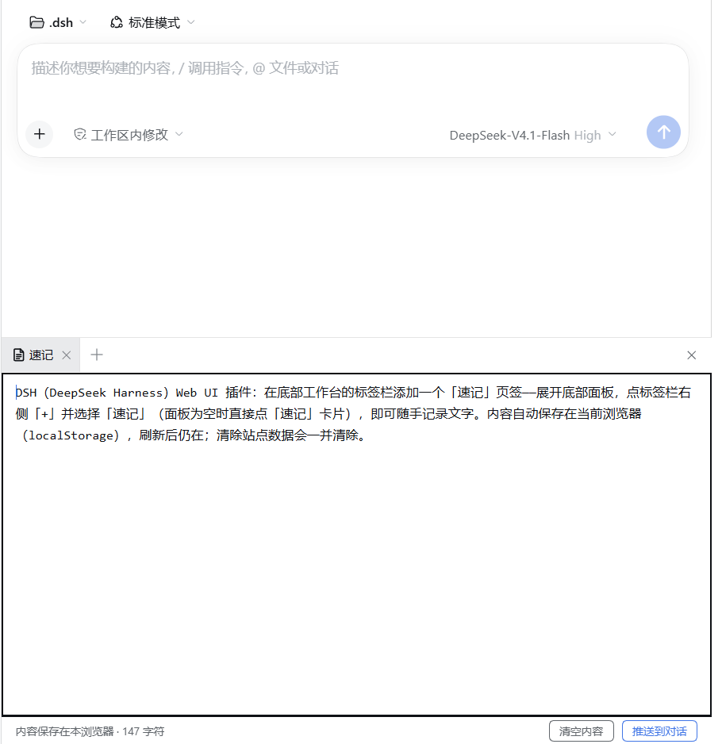

# dsh-freeform-notes

DSH（DeepSeek Harness）Web UI 插件：在底部工作台的标签栏添加一个「速记」页签——展开底部面板，点标签栏右侧「+」并选择「速记」（面板为空时直接点「速记」卡片），即可随手记录文字。内容自动保存在当前浏览器（localStorage），刷新后仍在；清除站点数据会一并清除。



## 功能

- **即开即写**：页签打开后编辑区自动获得焦点；纯文本域 + 等宽字体，无多余排版干扰。始终以纯编辑模式展示，**不做 Markdown 渲染或预览**。
- **Markdown 输入辅助（回车续行补全）**：列表行回车自动续接同款前缀——
  - 无序列表 `- ` / `* ` / `+ ` 原样续接；
  - 有序列表 `1. ` / `1) ` 自动递增序号（`1.` → `2.`）；
  - 任务列表 `- [x] ` 续项自动重置为未勾选 `- [ ] `；
  - 引用行 `> ` 自动续接 `> `，组合前缀原样续接：`> - ` → `> - `、`> 1. ` → `> 2. `、`> - [x] ` → `> - [ ] `，多级引用 `>> ` 同理；
  - 空列表项/空引用行回车则退出对应语法（`> - ` 空项先退到 `> `，再回车退出引用）；
  - Shift+回车强制普通换行（不续行），可随时中断补全。
- **推送到对话**：底部右侧【推送到对话】把速记全文**追加到 DSH 对话输入框的光标处**（空白感知衔接，光标落到插入文本之后；composer 已有内容时不覆盖）。仅写入草稿、**不自动发送**、**不绑定任何快捷键**；**推送成功后速记自动清空并落盘**（推送失败时保留，避免丢失）；【清空内容】手动清空并落盘。
- **自动保存**：输入停止 400ms 后防抖写入 localStorage；页签关闭、页面隐藏（`visibilitychange`）与页面卸载（`pagehide`）时立即落盘。
- **多标签页同步**：同一浏览器其他标签页写入的速记经 `storage` 事件实时同步；本页存在尚未落盘的输入时以本页为准，避免双方在防抖窗口内互相覆盖。
- **字素级字数统计**：以用户感知字符计数（`Intl.Segmenter`，grapheme 粒度），emoji、组合字符计 1；环境不支持 Segmenter 时退化为码点计数。
- **存储降级**：localStorage 不可用或已满时，状态栏转为错误提示（「内容仅保留在当前页面」），文本仍可在当前页面继续编辑，仅不持久化。
- **可访问性**：编辑区带 `aria-label`；保存失败经 `role="alert"` 向读屏播报；状态区保留 `title` 提示；键盘焦点有可见轮廓。
- **触屏适配**：粗指针设备上编辑区字号自动升至 16px，避免 iOS 聚焦缩放。
- **主题融合**：配色与字体全部取自宿主设计令牌（`--dsw-alias-*`、`--ds-font-family-code`），明暗主题自动跟随。
- **国际化**：注册表元数据 8 种语言（简体中文、English、日本語、Español、Français、Deutsch、Português、Русский）；页签内 UI 文案内置简体中文与 English，其余语言回退英文。

## 结构

```
dsh-freeform-notes/
├── package.json        # dsh.bundle + dsh.client 清单（DSH 唯一认的清单）
├── cordis.patch.yml    # 把 bundle 行挂载进 profile（行 id: freeform-notes）
├── index.js            # host 半（Node 进程），仅注册插件身份，无逻辑
├── client.js           # client 半（浏览器），全部功能在此
├── icon.svg            # 注册表/商店图标
├── locale/             # 注册表元数据：8 语言标题与简介（en/zh 另含详情页链接）
│   └── {zh,en,ja,es,fr,de,pt,ru}.json
└── docs/
    ├── DETAIL.md       # 详情页（英文）
    ├── DETAIL.zh.md    # 详情页（中文）
    └── preview.svg     # 预览图
```

零依赖、免构建：`index.js` / `client.js` 均为手写产物，安装后无需构建步骤。

## 安装（在运行 dsh web 的那台机器上执行）

从 GitHub 安装（推荐）：

```bash
dsh plugin --profile web add github:37duer/dsh-freeform-notes
```

或从本地目录安装：

```bash
dsh plugin --profile web add /path/to/dsh-freeform-notes
```

重启 dsh web 服务后生效。验证：展开底部面板，标签栏右侧「+」菜单中应出现「速记」。

卸载（以包名为准）：

```bash
dsh plugin --profile web remove '@local/dsh-freeform-notes'
```

> 标识说明：包名与 client 模块 id 为 `@local/dsh-freeform-notes`（见 `package.json` 与 `client.js`），bundle 行 id 为 `freeform-notes`（见 `cordis.patch.yml`）。

## 使用与数据

- **编辑**：打开页签即自动聚焦文本域，随输随记。底部左侧显示存储位置提示与字数（存储失败时提示转为「内容仅保留在当前页面」），右侧为【清空内容】【推送到对话】两个按钮（内容为空时禁用）。
- **持久化**：文本以 `{"text": "…"}` 写入 `localStorage`，键为 `dsh.freeform-notes.v1`。输入停止 400ms 后防抖落盘；页签关闭、页面隐藏、页面卸载时立即落盘。
- **多标签页**：其他标签页写入后当前页经 `storage` 事件同步；若本页有尚未落盘的输入，以本页为准。
- **隐私**：全部内容仅存于本浏览器；插件不发起任何网络请求，不上传文本。清除站点数据（或单独删除上述键）即永久删除速记，不可恢复。
- **存储异常**：localStorage 不可用或写满时转为错误状态（内容仅保留在当前页面），文本仍可继续编辑，仅不持久化。

## 配置

可调常量位于 `client.js` 顶部：

| 常量 | 默认值 | 说明 |
| --- | --- | --- |
| `STORAGE_KEY` | `dsh.freeform-notes.v1` | localStorage 键（改此值相当于换一本新速记） |
| `SAVE_DELAY` | `400` | 防抖落盘延迟（毫秒） |
| `LOCALE_NS` | `freeformNotes` | 文案命名空间 |

页签注册参数在 `client.js` 的 `registerTab` 调用处：`order: 45`（标签栏排序）、`bottomOnly: true`（仅底部工作台）、`single: true`（全局单实例）。

## 国际化

- **注册表元数据**（标题/简介/详情链接）：`locale/` 下 8 语言——简体中文、English、日本語、Español、Français、Deutsch、Português、Русский。
- **页签内 UI 文案**：内置简体中文与 English 两套（`client.js` 内的 `zh` / `en` 字典，命名空间 `freeformNotes`），其余语言回退英文；字数单位同样本地化（`{n} 字符` / `{n} chars`）。

## 已知限制

1. **单条速记**：仅一个文本域，暂无多笔记、Markdown 渲染/预览、检索或导出能力（编辑侧提供列表/引用回车续行等 Markdown 输入辅助）。
2. **仅本浏览器**：不做云同步与跨设备；换浏览器或清除站点数据即不可见/丢失。
3. **字数口径**：按字素计数（emoji、组合字符计 1），与按 UTF-16 码元计数的口径不同。
4. **DSH 处于 developer preview**：按 client 模块契约（`window.__ModuleLoader__.load` + `inject: ['locale', 'betterSidebar']` + `apply(ctx)`）与 `betterSidebar.registerTab` 契约编写；DSH 升级若变更该契约需同步调整。
5. **UI 语言仅 zh/en**：其余 6 种语言目前只有注册表元数据，页签内文案回退英文。
6. **推送依赖宿主 conversation 服务**：宿主未提供该服务或会话未就绪时，【推送到对话】给出失败提示并安全放弃（控制台留日志），速记本体不受影响。
