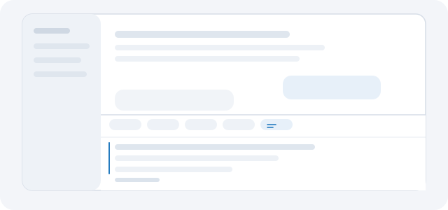

# Notes tab (速记)

Adds a **Notes** tab to the bottom workbench of DSH (DeepSeek Harness) Web UI. Expand the bottom panel, pick **Notes** from the tab strip's `+` menu (or the Notes card while the panel is empty), and jot text down. Everything you type is saved in this browser and restored on reload; clearing site data removes it.

## What you get

- **Instant scratch pad** — the editor focuses itself as soon as the tab opens; a plain text area set in a code font, with nothing else in the way. The note is always shown as plain editable text — Markdown is never rendered or previewed.
- **Markdown editing aids** — Enter continues the current Markdown prefix for you: `- ` / `* ` / `+ ` bullets, incrementing `1. ` numbers, task items restarting as `- [ ] `, `> ` quotes, and combinations like `> - ` (continued verbatim as `> - `; `> 1. ` steps to `> 2. `). Enter on an empty item drops its marker to exit the list or quote (`> - ` falls back to `> ` first), and Shift+Enter forces a plain newline.
- **Push to chat** — the footer's **Push to chat** button appends the whole note to the DSH chat input at its caret (whitespace-aware joins; existing draft text is kept). It only writes the draft — nothing is sent — it is bound to no keyboard shortcut, and the note stays in place afterwards. **Clear** empties the note in one click.
- **Autosave** — writes to `localStorage` 400 ms after you stop typing, and flushes immediately when the tab closes, the page hides, or the page unloads.
- **Multi-tab sync** — edits made in another tab of the same browser arrive via the `storage` event. While a save is pending locally, the local text wins, so two tabs cannot clobber each other mid-keystroke.
- **Honest character count** — counts user-perceived characters (graphemes) with `Intl.Segmenter`, so emoji and combining marks count once. Falls back to code-point counting where `Segmenter` is unavailable.
- **Graceful storage failure** — if `localStorage` is unavailable or full, the footer switches to an error state (“Kept on this page only”) and the text keeps working in memory.
- **Accessible and touch-friendly** — labelled editor, screen-reader alert on save failure, visible focus ring, and a 16 px base font on coarse pointers (no iOS focus zoom).
- **Theme-aware** — all colors and the editor font come from the host design tokens (`--dsw-alias-*`, `--ds-font-family-code`), so light and dark themes follow the host automatically.

## How the data is stored

- The note is kept as `{"text": "…"}` under the `localStorage` key `dsh.freeform-notes.v1`.
- Nothing ever leaves the browser: the plugin makes no network requests and uploads no note content.
- Deleting site data — or just that one key — deletes the note permanently.

## Requirements

- DSH Web UI with the `dsh-better-sidebar` module and the locale service available (both are injected).
- A browser with `localStorage` (any mainstream browser). `Intl.Segmenter` is used when present.

## Limitations

- One note per browser profile — no multiple notes, Markdown rendering/preview, search, or export yet (list and quote continuation aids are available while editing).
- Storage is per-browser only; there is no cloud sync across devices.
- In-tab UI strings are bundled for Chinese and English only; other locales fall back to English (listing metadata ships in 8 languages).
- DSH is in developer preview. The plugin follows the client module contract (`window.__ModuleLoader__.load` + `apply(ctx)`) and the `betterSidebar.registerTab` API, and may need adjustments if those contracts change.
- Pushing to the chat relies on the host's conversation service; when it is unavailable, the button reports failure and gives up safely.
